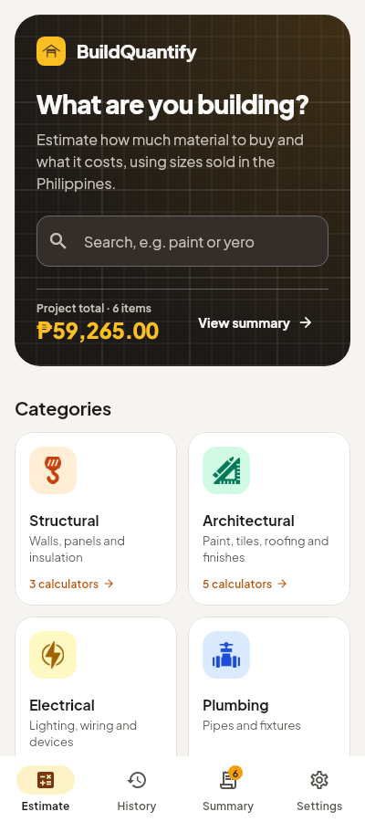
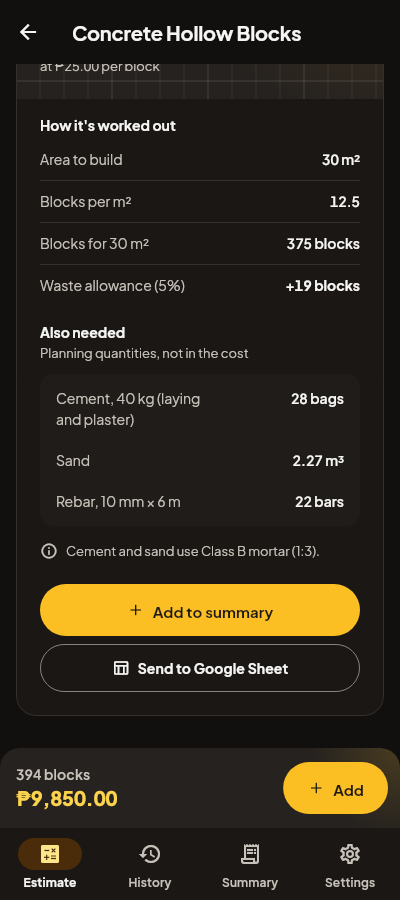
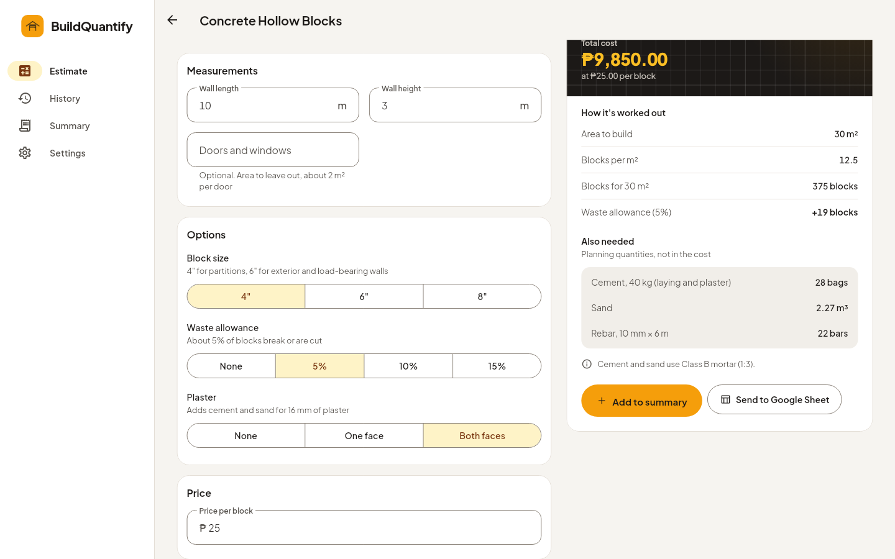

# BuildQuantify

BuildQuantify estimates how much of a construction material you need and
what it costs, using the sizes sold in the Philippines. It covers 19
materials in four groups. Estimates update as you type and list what else the
job needs (cement, sand, rebar, adhesive, fittings). The app keeps a history,
builds a bill of materials grouped by category, and can send estimates to a
Google Sheet. It works offline, in light or dark mode.

| Phone | Phone, dark | Desktop |
| --- | --- | --- |
|  |  |  |

- [How each material is calculated, with sources](docs/calculations.md)
- [Design system](docs/design-system.md) and [design QA](docs/design-qa.md)

- **Structural:** concrete hollow blocks, plywood, foam insulation
- **Architectural:** paint, tiles, roofing sheets, carpet, wallpaper
- **Electrical:** LED bulbs (sized by room), switches, junction boxes,
  outlets (spaced by the electrical code), wire, utility boxes
- **Plumbing:** PVC pipe, sinks, toilets, faucets, showers

> [!IMPORTANT]
> Earlier versions embedded a Google service-account private key in the
> source code and web build. It has been removed, but it is still in git
> history. Revoke it in Google Cloud Console → IAM & Admin → Service
> Accounts → `flutter-test@qualified-tea-408701.iam.gserviceaccount.com` →
> Keys (key `ea91bc…`). The app no longer needs any key; see
> [Google Sheets export](#google-sheets-export).

## Run it

Requires Flutter **3.47.7** (Dart 3.13).

```sh
flutter pub get
flutter run -d chrome
```

## Build for the web

```sh
flutter build web --release --no-web-resources-cdn \
  --dart-define=SHEETS_PROXY_URL=https://REGION-PROJECT.cloudfunctions.net/sheets-proxy
```

- `--no-web-resources-cdn` serves the CanvasKit renderer and fallback fonts
  with the app instead of from a Google CDN, so the app still loads on
  networks that block it.
- Without `SHEETS_PROXY_URL` the app works fully offline; the export
  buttons explain that Google Sheets export is not set up.
- URLs use the `#/` form (for example `#/category/structural/chb`), so any
  static host works without rewrite rules. Enable gzip or brotli on the host.

## Google Sheets export

The browser never holds Google credentials. Rows are sent to a small Cloud
Function in [`functions/sheets-proxy`](functions/sheets-proxy/README.md),
which runs as the service account without a key file and appends them to the
user's sheet. Users share their spreadsheet with the service account as an
Editor; Settings and the Help screen walk them through it.

## Test

```sh
flutter analyze
flutter test                                    # unit, widget and golden tests
flutter test --platform chrome test/data test/materials test/state
                                                # same logic compiled to JavaScript
```

Golden images are compared on Linux only, since font rendering differs
between operating systems. After an intended UI change, regenerate them on
Linux with `flutter test --update-goldens test/golden`.

The browser smoke test drives the release build in Chromium:

```sh
flutter build web --release --no-web-resources-cdn
python3 -m http.server 8090 --directory build/web &
cd tool/smoke && npm ci && npx playwright install chromium
BASE_URL=http://127.0.0.1:8090/ node smoke.mjs
```

CI runs all of the above on every push (`.github/workflows/ci.yml`).

## Project layout

```
lib/
  main.dart, app.dart      start-up, providers, theme
  router.dart              go_router routes, old-URL redirects
  core/                    theme, breakpoints, formatting, shared widgets
  data/                    Estimate model, storage, legacy import, Sheets client
  state/                   EstimatesController, SheetSettingsController
  materials/               the 19 calculators as data (MaterialSpec)
  features/                screens: home, category, calculator, history,
                           summary, settings, help, shell
assets/                    images and the Plus Jakarta Sans font (OFL)
docs/                      calculations, design system, design QA
functions/sheets-proxy/    Cloud Function for Google Sheets
tool/smoke/                Playwright smoke test
test/                      unit, widget and golden tests
```

UI code imports `package:material_ui/material_ui.dart`, which Flutter now
recommends over `package:flutter/material.dart`.

### Adding a material

1. Add a `MaterialSpec` to the right file in `lib/materials/` with its
   fields, choices, `compute` function, definitions, solution steps,
   sources and search keywords, and list it in `catalog.dart`.
2. Add its icon as `assets/images/materials/<id>.png` (192 px, one colour
   on transparent; the app tints it).
3. Add expected values to `test/materials/calculators_test.dart`.

The calculator screen, routing and summary pick it up automatically.

## Data

Estimates and sheet details are saved in the browser (SharedPreferences /
localStorage). On first start the app imports the history, summary and sheet
details saved by the original version; the old entries are left in place.

## Calculation changes

Quantities now follow Philippine estimating practice: 4-litre paint gallons,
real wallpaper roll and carpet roll sizes, roofing laid on the slope with
end laps, CHB with openings deducted and a 5% waste allowance by default, and
more. Saved estimates keep the values they were calculated with. See
[docs/calculations.md](docs/calculations.md) for every formula, its sources
and a before-and-after table.

## Other platforms

The Android, iOS and desktop folders are unchanged from the original project.
They have not been rebuilt with Flutter 3.47; run `flutter create .` to
refresh their build files if you build for them.
